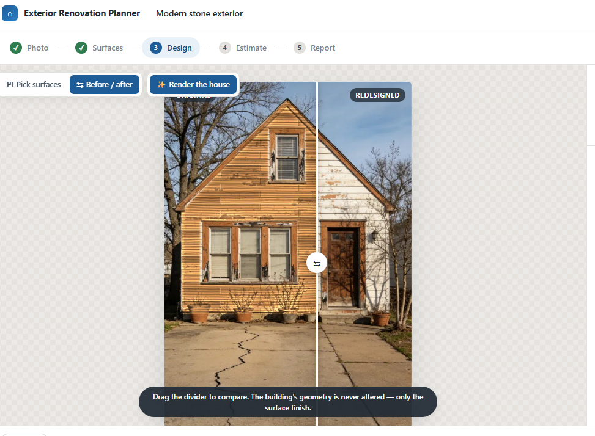
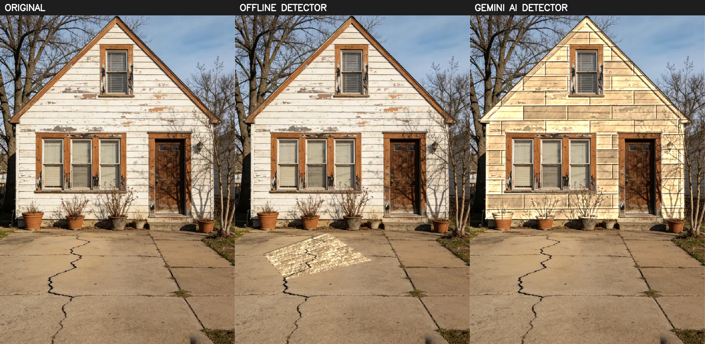

# AI-Based Exterior House Renovation & Cost Estimation System

A pre-construction planning assistant. Upload one photo of a house exterior,
mark its surfaces, try materials on them, and get measured quantities with a
transparent cost breakdown you can hand to a contractor.

**It runs completely offline.** No API keys, no network, no per-image cost.
Optional Gemini providers can be switched on later if you want them.



The renderer re-surfaces the actual uploaded photo — same geometry, same
windows, same shadows — it never generates a new image from scratch.

---

## Quick start

Two terminals. Python 3.10+ and Node 18+.

**Backend**

```bash
cd backend
python -m venv .venv
.venv\Scripts\activate          # Windows
# source .venv/bin/activate     # macOS / Linux
pip install -r requirements.txt
uvicorn app.main:app --reload --port 8000
```

**Frontend**

```bash
cd frontend
npm install
npm run dev
```

Open **http://127.0.0.1:5175**. API docs are at
http://127.0.0.1:8000/docs.

> The dev server uses port **5175**, not Vite's usual 5173, because 5173 was
> already taken on this machine by another project. Change it in
> `frontend/vite.config.ts` if you like; `strictPort` is on so a clash fails
> loudly instead of silently binding elsewhere.

Try it with `house_images/west-virginia-gray-cottage-64dd6bb056057.avif`.
(The other two sample files are small thumbnails and are correctly rejected by
the quality gate — useful for seeing that path work.)

---

## The workflow

| Step | What happens | Requirement |
|---|---|---|
| **1. Photo** | Any format normalises to sRGB JPEG; a quality gate grades sharpness, exposure, resolution and framing, and gives advice rather than a bare rejection. | 5.1 |
| **2. Surfaces** | Walls, roofs, openings, pillars and railings are detected automatically, then **you correct them** in a polygon editor. Openings nest into their wall so they are never painted or billed. The same step has a "Set scale" toggle: drag a handle onto something of known size — the front door by default — and every surface is rectified to remove perspective and reported in sq ft (or running ft) with the method and error band actually used. There is no separate scale-setting page to click through; it folds into this one. | 5.2, 5.5 |
| **3. Material Design** | Pick a material per surface from an editable catalog. The biggest surface is pre-selected so materials are visible the moment the step opens, and a material can be applied to every other matching surface in one click. The render re-surfaces your own photo using its own lighting; a wipe slider compares before and after. | 5.3, 5.4 |
| **4. Estimate** | Quantities with coverage, wastage and pack sizes; costs with every rate editable and every formula shown. | 5.6, 5.7 |
| **5. Report** | A PDF with both photos, measured surfaces, quantities, full costing, and a page stating what the estimate assumes. | 5.8 |

---

## Why the renderer does not use a generative model

Requirement 5.4 asks for the user's actual house, with the original building
structure preserved. A generative model redraws geometry it was only asked to
repaint — windows drift, rooflines change, the house stops being *their*
house.

So the renderer is a compositor. For each surface you marked it:

1. extracts a lighting map from the photograph (LAB lightness ÷ blurred
   lightness) — shadow, grime, soft occlusion, surface grain;
2. builds the new material **in rectified space at its real-world size**, so a
   600×300 mm tile is drawn 600×300 mm;
3. warps it through that surface's own perspective and multiplies by the
   lighting map.

Geometry is never touched, shadows survive, and it costs nothing per render.
Materials are generated procedurally with numpy — no bundled image assets.

---

## Optional: enable Gemini

Everything works without this. But it is **strongly recommended** once you
have a credential: see [Why AI segmentation matters](#why-ai-segmentation-matters)
below for a direct before/after on a real photo that moved region detection
from unusable to clean in one call.

```bash
cd backend
pip install -r requirements-ai.txt
cp .env.example .env     # then set one of the two paths below
```

Two credential paths, either is enough:

| Path | Set in `.env` | Notes |
|---|---|---|
| AI Studio | `GEMINI_API_KEY` | Simplest. Get one at aistudio.google.com/apikey. |
| Vertex AI | `VERTEX_PROJECT` + `GOOGLE_APPLICATION_CREDENTIALS` (absolute path to a service-account JSON key, not committed -- see below) | Use if you're already on GCP. |

#### Getting a Vertex AI service-account key

Skip this if you're using AI Studio instead (the simpler path, above).

1. In [Google Cloud Console](https://console.cloud.google.com/), pick or create
   a project, and confirm **billing is linked** to it -- Vertex AI calls fail
   without it, and the failure doesn't say so plainly.
2. Enable the **Vertex AI API** for that project (APIs & Services → Enable
   APIs → "Vertex AI API").
3. Create a service account with the **Vertex AI User** role: IAM & Admin →
   Service Accounts → Create → grant that role → Keys tab → Add key → JSON.
   This downloads a `.json` key file.
   Equivalently, with the `gcloud` CLI:
   ```bash
   gcloud iam service-accounts create vertex-renovation --display-name "Vertex AI (renovation app)"
   gcloud projects add-iam-policy-binding YOUR_PROJECT_ID \
     --member="serviceAccount:vertex-renovation@YOUR_PROJECT_ID.iam.gserviceaccount.com" \
     --role="roles/aiplatform.user"
   gcloud iam service-accounts keys create backend/vertex-key.json \
     --iam-account="vertex-renovation@YOUR_PROJECT_ID.iam.gserviceaccount.com"
   ```
4. Place the downloaded file at **`backend/vertex-key.json`**. That exact path
   is already covered by `.gitignore` (`backend/vertex-key.json`, plus
   `service-account*.json` and `*.json.key` as a general guard) -- putting it
   there means you can't accidentally commit it. Any other path works too, as
   long as it isn't inside something git tracks.
5. In `backend/.env`, set:
   ```
   VERTEX_PROJECT=your-gcp-project-id
   GOOGLE_APPLICATION_CREDENTIALS=/absolute/path/to/backend/vertex-key.json
   ```
   This has to be an **absolute path** -- a relative one resolves against
   whatever directory the process happens to be started from, which changes
   depending on how you launch it and breaks the moment it doesn't. On
   Windows that looks like `C:\full\path\to\backend\vertex-key.json`; on
   macOS/Linux, `/full/path/to/backend/vertex-key.json`.
6. Restart the backend after editing `.env` -- settings are read once at
   startup and cached, so an edit alone doesn't take effect on a running
   server.

Two gotchas that cost real debugging time while wiring this up, both now
handled by the code but worth knowing:

- **Vertex AI's Gemini models only answer on `location=global`, `us` or
  `eu`.** A regional location like `us-central1` returns a 404, even though
  the model shows up fine in that region's model catalog listing.
- **`thinking_level: "minimal"`** is documented for this model family but
  Vertex AI rejects it ("Thinking level is unsupported"); AI Studio accepts
  it. `"low"` works on both, so that's the default (`AI_THINKING_LEVEL`).

| Flag | Model | Cost |
|---|---|---|
| `ENABLE_AI_SEGMENTATION=true` | `gemini-3.8-flash` | AI Studio: free tier. Vertex AI: billed, no free tier. |
| `ENABLE_AI_RENDER=true` | `gemini-nano-banana-2.1` | **No free tier either way**, ≈ $0.034 per 1K image. |

AI segmentation replaces the classical detector; the offline compositor still
does the actual rendering either way (that part doesn't need a redesign --
see below). AI render adds a photoreal finishing pass **over** the offline
composite, conditioned on both the original and the composite and explicitly
told not to move anything. Any failure on either path falls back to offline
silently.

### Why AI segmentation matters

A real test photo (`house_images/home-design-ai/`, a renovation-in-progress
facade with peeling paint and bare wood) broke the offline detector outright:
its highest-confidence "wall" was the **driveway**.



Same photo, same material, same renderer -- only the region source changed.
Gemini's wall polygon also wasn't a simple quad (7 points, tracing the real
gable silhouette), which is the other thing that was breaking manual
correction: an auto-detected region snapped to 4 corners genuinely cannot
represent an L-shaped or gabled wall. The editor's edge-midpoint `+` handles
(click any edge of a selected shape to add a corner there) fix that for
manual work regardless of which detector you use.

---

## Tests

```bash
cd backend
.venv\Scripts\python -m pytest
```

71 tests. They cover the perspective maths against synthetically projected
rectangles (where the right answer is known exactly), the quantity and costing
arithmetic to the rupee, format handling against the real sample photos
including the AVIF and the JFIF, and the full HTTP journey from upload to PDF.

---

## Documentation

- **[docs/ARCHITECTURE.md](docs/ARCHITECTURE.md)** — pipeline, layout, data
  model, API, the design decisions and why.
- **[docs/ESTIMATION_METHOD.md](docs/ESTIMATION_METHOD.md)** — every formula,
  the three accuracy tiers, a worked example checked against the code.
- **[docs/LIMITATIONS.md](docs/LIMITATIONS.md)** — read before trusting a
  number. What one photo cannot tell you, where detection fails, how volatile
  the rates are.

---

## Honest status

What works well: format handling, the quality gate, perspective-corrected
measurement once a reference is confirmed, the renderer, and all of the
quantity and cost arithmetic.

**Automatic surface detection without an AI key is genuinely weak**, and
real-world testing found a worse failure than this document first let on: on
a renovation-in-progress facade, the offline detector's highest-confidence
"wall" was the driveway, and the stone cladding got rendered onto the ground
rather than the house. Classical colour-clustering CV cannot reliably tell a
facade from its surroundings on an arbitrary photo. The polygon editor and
the non-skippable review step exist because of exactly this — but editing a
bad detection is still editing a bad detection. **If you can get a Gemini
credential (either path, see above), do** — the same photo goes from an
unusable region set to four clean, correctly-labelled surfaces in one call,
with the wall traced as its real non-rectangular shape rather than snapped to
a quad. The offline detector remains the default and the fallback, not
because it's adequate, but because the brief asks for a system that works
with no network access at all.

Two things fixed after initial real-world testing, both load-bearing for the
"review and correct" workflow to actually work:

- **Adding a corner to an existing polygon needed a hidden keyboard modifier**
  (shift/alt-click on an edge) that nobody found, which meant anyone whose
  wall wasn't a simple rectangle — including every auto-detected region,
  which starts life snapped to a quad — had no practical way to fix it. Every
  edge of a selected shape now shows a dashed `+` that adds a corner there on
  a plain click.
- **A window or door only got excluded from its wall's paint and area if you
  explicitly linked it** via a "cut out of which surface?" dropdown almost
  nobody discovers — so a repaint would render straight over the windows.
  Openings are now excluded automatically by geometric overlap (does this
  shape's area mostly sit inside that wall?), with the manual link kept as a
  fallback for overlaps too small to clear the threshold on their own.

The other thing worth knowing: **confirming the scale is the highest-leverage
action in the whole workflow.** The auto-placed reference is a guess, and on
the sample photo it under-read areas by about 2.5× versus a correctly placed
door reference. The UI nags about this for good reason.

---

## Scope

Exterior only, low-rise residential, advisory. No interior design, no
structural engineering, no statutory compliance, and nothing here is a
quotation.
